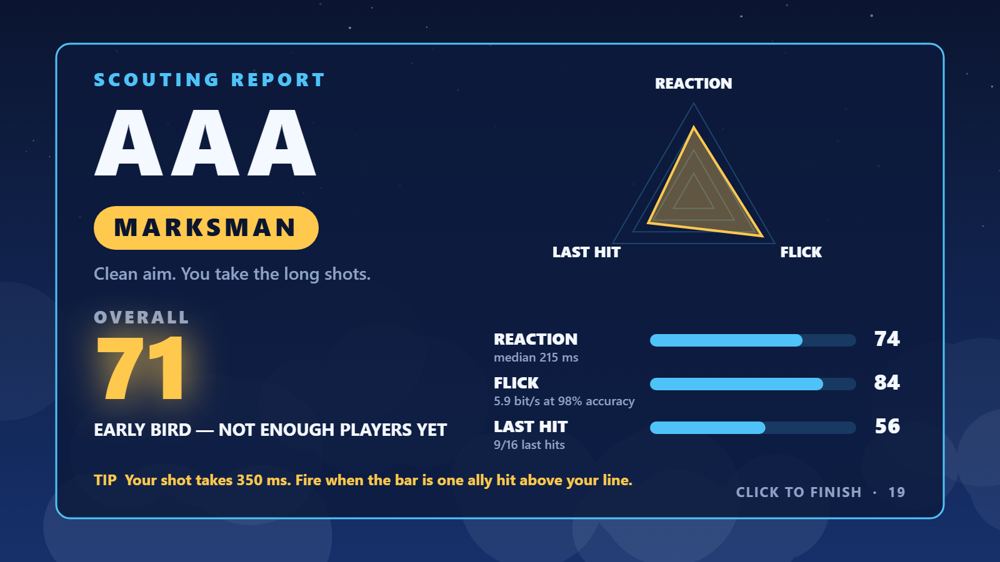
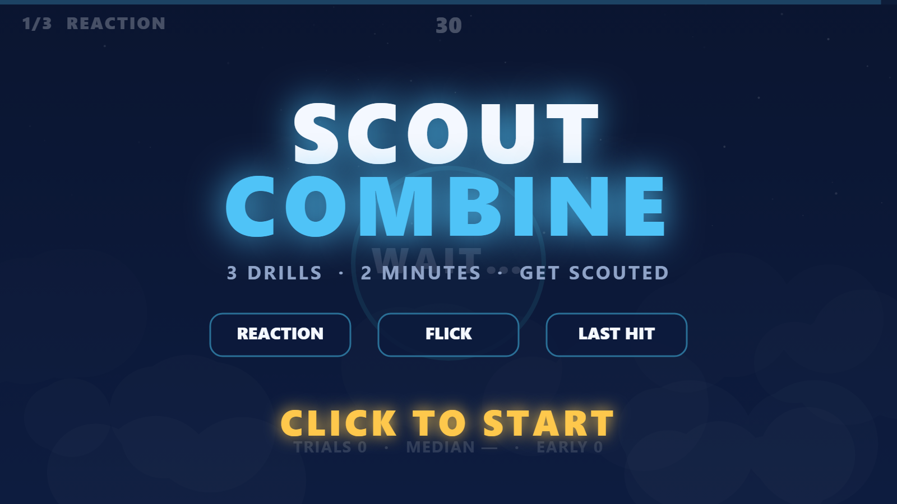
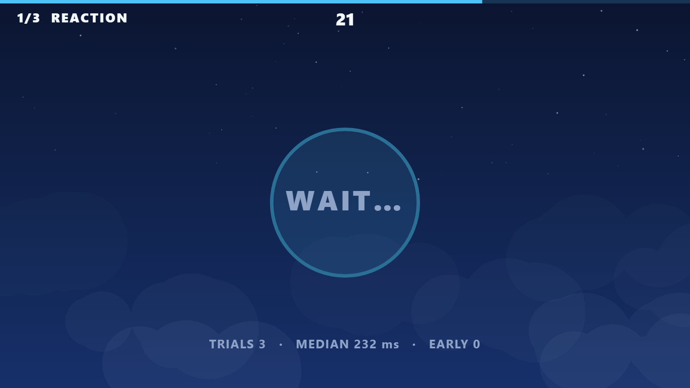
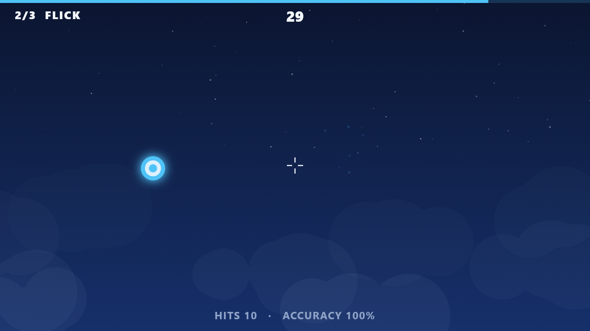
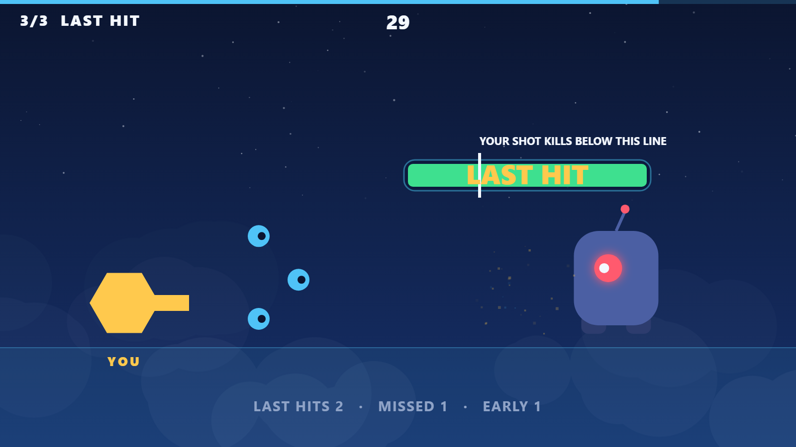
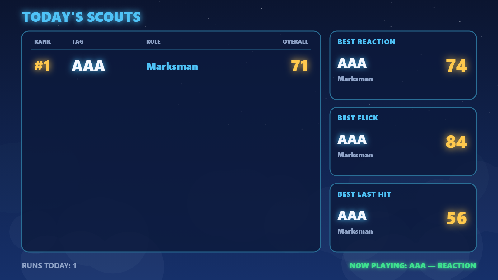

# Scout Combine

A booth mini game for esports events. In about two minutes a fan plays three drills that measure real competitive-gaming skills, then gets a **scouting card** like the reports coaches write about pros. A second window on another monitor shows **today's leaderboard live**. No internet, no accounts, no tutorial: a mouse is enough.

Built for the Cloud9 x JetBrains "Sky's The Limit" hackathon, category 3 (Event Mini Game), with WebStorm and Junie.

**Demo video (2:39):** https://youtu.be/U29IVTTECA8

**Play it:** https://scout-combine-hoken-tech.pages.dev (game) and https://scout-combine-hoken-tech.pages.dev/board.html (leaderboard, open it in a second window). Runs are saved only in your own browser. After the first visit both pages also work offline.



## The run

| Step | What happens | Time |
|---|---|---|
| Attract screen | A bot plays the drills behind the title. Any click starts. | — |
| Tag | Three arcade letters with the mouse or the arrow keys. No free text, no personal data. | ~5 s |
| **Reaction** | Click when the panel turns into a green diamond. Early clicks are counted as false starts. Score: median reaction time. | 30 s |
| **Flick** | Click targets that jump across the screen and shrink. Score: Fitts throughput (bit/s) times accuracy. | 35 s |
| **Last Hit** | Allied drones chip a robot's health in a steady rhythm. Your shot lands 350 ms after the click and kills only below the line: time it. Score: share of units you finished. | 35 s |
| Scouting card | Overall score, role (Opener, Marksman, Finisher or Flex), radar, the raw number behind each score, a tip for the weakest drill, and how you rank among today's players. | 20 s or a click |

Each drill shows its one rule for two seconds before it starts. The action key (Space or Enter) also works in Reaction and Last Hit.

| Attract | Reaction | Flick | Last Hit |
|---|---|---|---|
|  |  |  |  |

## Running it at a booth

```bash
npm ci
npm run build
npx vite preview --port 5180     # or any static server for dist/
```

1. **Game window:** open `http://localhost:5180/` on the player's monitor and press **F11**.
2. **Board window:** open `http://localhost:5180/board.html` in a second window, drag it to the second monitor and press **F11**. It updates live while people play.
3. **Offline:** after this first visit a service worker has cached everything. Both pages keep working with the network unplugged, even after a reload.
4. **Operator menu:** **Ctrl+Shift+O** on the game window (players never see it). Sound on/off, fullscreen, **Export CSV** of every run, **Clear today** (three presses in a row, so it can't happen by accident), runs saved and an error count. The game pauses while the menu is open.

Runs are stored in the browser's IndexedDB on that PC. A day is the PC's local calendar date: within a minute of midnight the board switches to the new, empty day, and older runs stay stored for the CSV export. If storage fails, the run still plays, the card says "NOT SAVED — TELL THE BOOTH STAFF", the board says "LEADERBOARD UNAVAILABLE — STORAGE ERROR" instead of looking empty, and the operator menu counts the errors.



## For judges

| What the brief asks | Where to see it |
|---|---|
| Matches under 3 minutes, replayable | About 2 minutes per run. Scores are 0–100 per drill and comparable across runs: [`docs/BALANCE.md`](docs/BALANCE.md) shows 200 bot runs per skill level, clearly separated (overall medians 26 / 54 / 80). |
| Mouse, arrows or one button; no tutorial | Mouse only; arrows for the tag; Space/Enter as the action key. One rule card per drill. |
| A real gamer skill | Reaction time, flick aim (Fitts throughput, the standard aiming measure) and last-hit timing from lane-based games. |
| Complete loop: start, play, score screen | Attract → tag → three drills → scouting card → attract. End-to-end test: [`e2e/run.spec.ts`](e2e/run.spec.ts). |
| Resets cleanly, responsive under sustained use | Soak test: 2,000 runs back to back, then 10 minutes in real time. Heap +1 MB, DOM constant, 0.4 ms of work per frame at p95, 0 console errors: [`docs/SOAK.md`](docs/SOAK.md). |
| Local live leaderboard on a separate monitor, offline | `board.html` over IndexedDB + BroadcastChannel, no server. Tests: [`e2e/board.spec.ts`](e2e/board.spec.ts), [`e2e/offline.spec.ts`](e2e/offline.spec.ts). |
| JetBrains tools actually used | WebStorm project (`.idea/` run configurations), Junie CLI for the board and the CSV export (`.junie/`). Every task and what we changed: [`AI_SHOWCASE.md`](AI_SHOWCASE.md). How we worked: [`docs/METHODOLOGY.md`](docs/METHODOLOGY.md). |

## Tools

- **WebStorm 2026.3** is the project IDE: open the folder and run `dev`, `test`, `e2e`, `soak` or `balance` from the shared run configurations in `.idea/runConfigurations`.
- **Junie CLI** (headless, `junie --task`) built two whole features from written briefs: the live board and the CSV export. The briefs are in `.junie/tasks/`, the project rules Junie follows are in `.junie/guidelines.md`.
- **Claude Code** was used too, for the spec, the plan, most of the game code, the bots, the tests and the reviews. `AI_SHOWCASE.md` says which tool did what.

## Development

```bash
npm test            # 93 unit tests (Vitest): drills, scoring, run flow, store, board state, settings...
npm run e2e         # 8 Playwright tests on the production build (run, board, offline, CSV export, storage failure)
npm run balance     # bots at three skill levels, writes docs/BALANCE.md
npm run soak        # 2,000-run soak test against a running preview on port 5180, writes docs/SOAK.md
```

URL parameters for testing: `?autoplay=casual|average|sharp` (a bot plays real runs) and `?speed=n` (game clock n times faster). Bot runs are saved like real ones, tagged `BOT`: don't use autoplay on the booth PC during an event, or clear the day afterwards.

Stack: TypeScript, Vite, Canvas 2D, Web Audio. **No image, sound or font files**: every shape is drawn and every sound synthesised in code. Drills are pure state machines with an injected random generator, so tests and bots run them faster than real time.

## Limits

- One booth PC: runs live in that browser's storage. Use Export CSV to keep them.
- Flick needs aiming, so there is no one-button mode.
- Headless soak numbers are a pessimistic bound (software drawing); a booth PC with a GPU does better.
- Original names and art only: no team, league or game trademarks inside the game.

## Licence

MIT, see [`LICENSE`](LICENSE). © 2026 Hoken Tech S.R.L.
